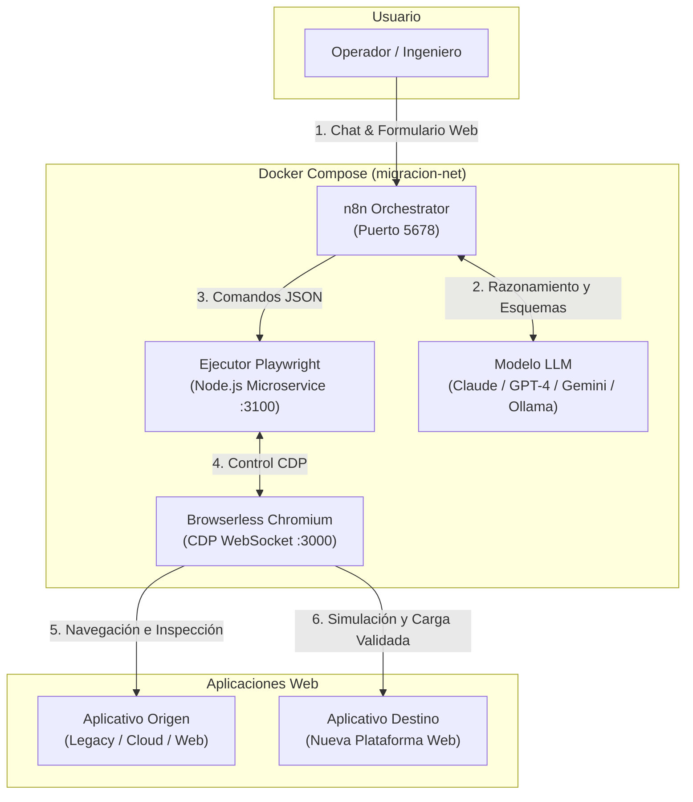

# 🚀 n8n UI-to-UI Migrator (RPA + Playwright + LLM)

Sistema autónomo y asistido para la **migración de datos interfaz a interfaz (UI to UI)** entre plataformas web, combinando la orquestación visual de **n8n**, el poder de automatización de navegadores de **Playwright / Browserless** y el razonamiento contextual de **Modelos de Lenguaje (LLMs)** mediante **LangChain**.

---

## 📌 ¿Qué es y qué problema resuelve?

En muchas organizaciones, migrar información entre sistemas empresariales (ERPs, CRMs, portales legacy o plataformas cloud cerradas) presenta grandes barreras:
- ❌ **No hay acceso a la base de datos** del sistema de origen o destino.
- ❌ **No existen APIs documentadas** o el acceso a ellas está restringido por licencias.
- ❌ **La lógica de negocio reside en el frontend**: validaciones complejas, campos calculados, dependencias de selects y flujos de modales.

**n8n UI-to-UI Migrator** resuelve esto tratando el navegador web como el conector universal:
1. **Inspecciona y extrae** los datos navegando la interfaz del sistema origen como un usuario real.
2. **Sintetiza una receta de carga** con ayuda de un LLM analizando el formulario de destino.
3. **Simula y valida en seco** (dry-run) sin escribir datos erróneos.
4. **Ejecuta la migración masiva** interactuando con la interfaz de destino y validando las respuestas HTTP subyacentes.

---

## 🛠️ Tecnologías Utilizadas

| Componente | Tecnología | Rol en la Arquitectura |
| :--- | :--- | :--- |
| **Orquestador** | [n8n](https://n8n.io/) (vía Docker) | Flujos visuales, webhooks, formularios multipágina, chat interactivo y nodos LangChain. |
| **Motor de Automatización** | [Playwright](https://playwright.dev/) + Node.js | Microservicio ejecutor (`/explorar`, `/leer-registros`, `/ejecutar-receta`) con Chromium, Firefox y WebKit. |
| **Navegador Remoto** | [Browserless](https://browserless.io/) (Chromium) | Instancia Headless Chromium optimizada, gestionada vía WebSocket CDP (`ws://browserless:3000`). |
| **Cerebro / Razonamiento** | **LangChain + LLMs** (Claude, OpenAI, Gemini u Ollama) | Entrevista inicial, inferencia de mapeos de datos, generación de recetas y auto-reparación de selectores. |
| **Infraestructura** | **Docker & Docker Compose** | Entorno contenedorizado listo para producción con red interna segura (`migracion-net`). |

---

## 🏗️ Arquitectura del Sistema



---

## 🛡️ Mecanismos de Seguridad y Resiliencia

1. **Safe Read-Only Guard (Filtro de Red Estricto):**
   Durante la exploración del origen y la simulación en el destino, el microservicio ejecutor **aborta inmediatamente** toda petición que no sea `GET`, `HEAD` u `OPTIONS`. El modelo no puede escribir por accidente.
2. **Validación HTTP Real (No en Toasts):**
   Al guardar registros, el sistema no confía en mensajes emergentes o animaciones de pantalla; escucha el evento de red de Playwright (`page.waitForResponse`) y exige un código de estado `2xx` del endpoint de backend.
3. **Localizadores Resilientes:**
   Prioriza selectores accesibles y semánticos (`getByLabel`, `getByPlaceholder`, `getByRole`) por encima de selectores frágiles como clases CSS dinámicas o XPaths fijos.
4. **Auto-Reparación con `ariaSnapshot`:**
   Si una receta falla durante la ejecución, el ejecutor captura el árbol de accesibilidad de la pantalla en ese instante para que el LLM pueda sugerir la corrección exacta.

---

## 📁 Flujos de n8n Incluidos

Los flujos se encuentran en `n8n/flujos/` listos para importar:

### 1. `MigrAsistente001.json` — Asistente de Configuración (Chat)
- Interfaz de chat interactiva (`hostedChat`).
- Realiza el diagnóstico inicial: aplicativos involucrados, entidades, catálogos requeridos, tipo de autenticación (cookies, tokens, OTP) y alcance del piloto.
- Entrega un JSON estructurado listo para alimentar el flujo de ejecución.

### 2. `MigrEjecucion002.json` — Exploración, Plan y Ejecución (Formulario)
- **Fase 1 (Exploración):** El ejecutor visita las pantallas y modales, leyendo campos, selects y capturando endpoints JSON.
- **Fase 2 (Plan con IA):** El LLM procesa los esquemas y genera la receta paso a paso (`ir`, `clic`, `llenar`, `seleccionar`, `guardar`).
- **Fase 3 (Simulación en Seco):** Se ejecuta la receta sin enviar peticiones de escritura.
- **Fase 4 (Piloto):** Ejecución con 1 o 2 registros reales y espera de aprobación humana (*Human-in-the-Loop*).
- **Fase 5 (Ejecución Masiva):** Carga del lote completo con exportación de reporte CSV.

---

## 🚀 Guía de Instalación y Uso en Pasos Sencillos

### Paso 1: Prerrequisitos
Asegúrate de tener instalados:
- [Docker Desktop](https://www.docker.com/products/docker-desktop/) (con WSL2 en Windows o nativo en Linux/macOS).
- [Git](https://git-scm.com/).
- [Node.js](https://nodejs.org/) v18+ (opcional, solo si deseas modificar scripts localmente).

---

### Paso 2: Clonar el Repositorio y Configurar Entorno
```bash
git clone https://github.com/Samuel-Junieles/n8n-ui-to-ui-migrator.git
cd n8n-ui-to-ui-migrator
cp .env.example .env
```

---

### Paso 3: Iniciar los Servicios
Inicia el orquestador, el ejecutor de Playwright y Browserless con Docker Compose:

```bash
docker compose up -d --build
```

Verifica que los tres contenedores estén en estado `Up`:
```bash
docker compose ps
```
Deberías ver:
- `n8n_orchestrator` en el puerto `5678`
- `browserless_service` en el puerto `3000`
- `ejecutor_playwright` (red interna)

---

### Paso 4: Acceder a n8n e Importar los Flujos
1. Abre en tu navegador: [http://localhost:5678](http://localhost:5678)
2. Crea tu cuenta local de n8n si es la primera vez que lo abres.
3. En el menú lateral, haz clic en **Workflows** ➔ **Add Workflow** ➔ **Import from File...**
4. Selecciona e importa ambos archivos:
   - `n8n/flujos/MigrAsistente001.json`
   - `n8n/flujos/MigrEjecucion002.json`
5. Activa los flujos (*Active: ON*).

---

### Paso 5: Configurar Credenciales de IA en n8n
1. Abre el flujo importado en n8n.
2. Localiza los nodos de modelo de IA (por ejemplo: `Modelo – configurador`).
3. Por defecto viene preparado para **Anthropic** (Claude 3.5 Sonnet / Opus 5.5). Haz doble clic en el nodo y añade tu API Key.
4. **¿Prefieres otro proveedor?**
   - Puedes reemplazar el subnodo por **OpenAI Chat Model**, **Google Gemini Chat Model** o **Ollama Chat Model** (100% local y gratuito) sin modificar el resto del flujo.

---

### Paso 6: Ejecutar la Migración
1. Abre la URL pública del chat del **Flujo 1** (disponible en el webhook del nodo `Chat de migración`).
2. Describe tu escenario (por ejemplo: *"Quiero migrar 150 proyectos desde el portal X al portal Y, con sus campos básicos y estado"*).
3. El asistente te guiará y te entregará el JSON de configuración.
4. Abre el formulario del **Flujo 2** y pega la configuración.
5. Observa cómo el sistema:
   - Explora las pantallas de origen y destino.
   - Diseña la receta de migración con IA.
   - Ejecuta la prueba piloto con 1 registro.
   - Solicita tu aprobación en pantalla para proceder con el lote masivo.
   - Descarga tu reporte de auditoría en formato CSV al finalizar.

---

## 📡 Endpoints del Microservicio Ejecutor (`ejecutor/`)

El servicio interno de Playwright expone los siguientes endpoints (dentro de la red Docker):

- `GET /salud`
  - Comprobación de estado y navegadores disponibles (`chromium`, `firefox`, `webkit`, `chromium_remoto`).
- `POST /explorar`
  - Inspecciona páginas web, captura modales y recolecta respuestas GET de red en formato JSON.
- `POST /leer-registros`
  - Realiza peticiones autenticadas desde el contexto del navegador para extraer listas de datos.
- `POST /ejecutar-receta`
  - Ejecuta la secuencia de pasos (`ir`, `clic`, `llenar`, `seleccionar`, `guardar`) con soporte para simulación segura (*dry-run*).

---

## 🛠️ Regenerar los Flujos Programáticamente
Si modificas la lógica en `n8n/generar.mjs`, puedes reconstruir los archivos JSON de los flujos ejecutando:

```bash
npm run flujos:generar
```

---

## 📄 Licencia

Este proyecto está bajo la Licencia **MIT**. Consulta el archivo [LICENSE](LICENSE) para más detalles.
